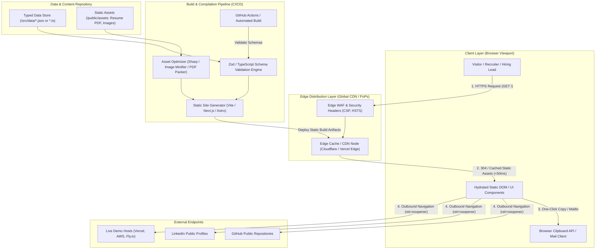
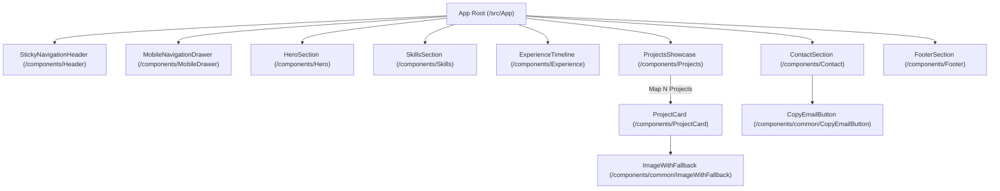
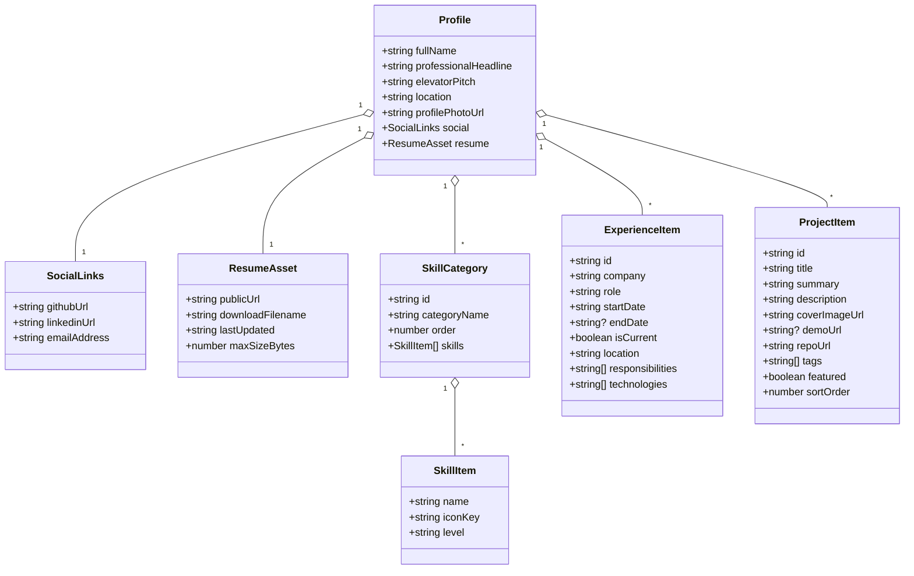
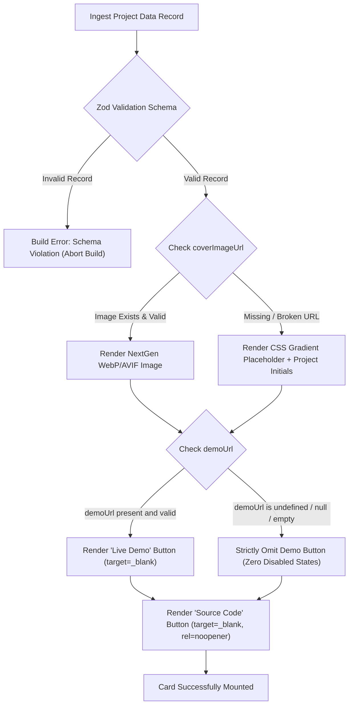

# System Architecture Document (SAD)
## Personal Professional Portfolio System

| Metadata | Specification |
| :--- | :--- |
| **System Name** | Personal Professional Portfolio |
| **Document Version** | 1.0.0 |
| **Document Status** | Approved for Implementation |
| **Target Role** | Full Stack Developer |
| **Author** | System Architecture Team |
| **Governing PRD** | `PRD.md` (v1.3.0) |
| **Scope** | Frontend, Backend/Edge, Data, Security, DevOps, Resilience (Zero-Code Architecture) |

---

## 1. Architectural Drivers & System Requirements

### 1.1 Business Goals & Quality Attributes
* **Ultra-Low Latency:** Time to Interactive (TTI) $< 1.5\text{s}$, Largest Contentful Paint (LCP) $< 1.2\text{s}$, Cumulative Layout Shift (CLS) $= 0$.
* **High Availability (99.99%):** Static Edge delivery across globally distributed Points of Presence (PoPs) with zero reliance on single-instance origin servers.
* **Deterministic Scalability:** Seamless rendering of dynamic project collections ($N \ge 1$) driven by typed data structures without layout reflows or code changes.
* **Zero-Friction Conversion:** Frictionless access to ATS-compliant resume and spam-resistant contact paths (clipboard copy + mailto protocol).
* **Cost Efficiency:** \$0/month baseline operational cost on serverless/edge tier with automated scale-to-zero capabilities.

### 1.2 System Constraints & Boundaries
* No persistent relational/NoSQL database required for read paths in MVP; data lives in statically validated schemas compiled at build time.
* Anti-scraping policy: No raw telephone numbers or exposed unmasked API keys in client-side bundles.
* Standard WCAG 2.1 AA accessibility compliance across all interactive surfaces.

---

## 2. High-Level System Architecture & Topology

The system uses a **JAMstack / Edge-First Static Site Generation (SSG)** architecture paired with edge CDN distribution and modular data ingestion pipelines.



---

## 3. Frontend Architecture

### 3.1 Component Hierarchy & Tree Decomposition
The user interface is modeled as a strictly decoupled tree of composable, pure presentational components consuming centralized typed configuration.



### 3.2 State Management & Interaction Architecture
* **Global State Scope:** **Zero unnecessary global stores.** Navigation state (e.g., `isMobileMenuOpen: boolean`) and user interaction state (e.g., `copySuccessState: boolean`, `activeSection: string`) reside within local component boundaries or custom hooks (`useClipboard`, `useScrollSpy`).
* **Scroll Spy Mechanism:** Uses `IntersectionObserver` API configured with an observer threshold of `0.6` to track active sections dynamically and update navigation highlighting without thrashing CPU cycles on window scroll events.
* **Clipboard Interaction Engine:**
  ```mermaid
  sequenceDiagram
      autonumber
      actor Visitor
      participant UI as CopyEmailButton
      participant API as Navigator.clipboard API
      participant Fallback as execCommand / Input Fallback
      participant Timer as 3000ms Auto-Reset Timer

      Visitor->>UI: Click "Copy Email"
      alt navigator.clipboard is available
          UI->>API: writeText("alex@domain.com")
          API-->>UI: Promise Resolved
      else Secure Context / Permission Denied
          UI->>Fallback: Create temporary hidden input, execCommand('copy')
          Fallback-->>UI: Fallback Success
      end
      UI->>UI: Set state: isCopied = true (Render "Copied!")
      UI->>Timer: Start 3000ms countdown
      Timer-->>UI: Timer expires
      UI->>UI: Reset state: isCopied = false (Render "Copy Email")
  ```

### 3.3 Performance & Core Web Vitals Budget
| Metric | Threshold Target | Architectural Strategy |
| :--- | :--- | :--- |
| **LCP (Largest Contentful Paint)** | $< 1.2\text{s}$ | Preload Hero profile image; inline critical above-the-fold CSS; defer non-critical scripts. |
| **CLS (Cumulative Layout Shift)** | $= 0.00$ | Explicit `width` and `height` aspect-ratio reserves on all image containers and project card slots. |
| **INP / FID (Interaction to Next Paint)** | $< 50\text{ms}$ | Zero heavy client-side computation; event listeners use passive flags; small lightweight JS bundle ($< 50\text{KB}$ gzipped). |
| **Bundle Size Budget** | $< 100\text{KB}$ | Zero redundant UI runtime dependencies; tree-shaken modern icon library. |

---

## 4. Backend & Edge Service Architecture

### 4.1 Backend Topology: Evolution from SSG to Edge
While Phase 1 requires zero server-side database infrastructure per stakeholder decisions, the backend is architected for extensible evolution:

* **Phase 1 (MVP Baseline):**
  * **Static File Distribution:** Serverless Edge distribution via CDN (Cloudflare Pages, Vercel, or Netlify).
  * **Direct Mail Protocols:** Direct OS/Webmail triggering via RFC-6068 compliant `mailto:` query strings and client-side clipboard ingestion.
* **Phase 2 (Optional Extensibility Layer - Micro-API):**
  * Edge Function / Serverless Lambda (e.g., `/api/contact` or `/api/metrics`) if automated email forwarding (via Resend/SendGrid) or privacy-preserving view counters are introduced later.
  * Architecture Contract: Edge runtime (V8 isolate), stateless, Cold start $< 15\text{ms}$, rate-limited via Edge KV/Upstash.

### 4.2 Edge Caching & Response Policy
* **HTML Documents (`/index.html`):** `Cache-Control: public, max-age=0, must-revalidate` (instant cache invalidation on deployment).
* **Static Assets (`/assets/*.[hash].js`, `*.css`):** `Cache-Control: public, max-age=31536000, immutable` (fingerprinted cache forever).
* **Resume PDF (`/Alex_Morgan_Full_Stack_Developer_Resume.pdf`):** `Cache-Control: public, max-age=3600, stale-while-revalidate=86400` (allows updates within 1 hour while serving fast cached copy).

---

## 5. Data Architecture & Storage Schema

All content is structured as **Type-Safe Ingestible Data Objects (TSIDO)** validated during build time via schema definitions (Zod/TypeScript).

### 5.1 Data Models (Entity-Relationship & Schemas)



### 5.2 Deterministic Project Ingestion & Degradation Rule Engine


---

## 6. Security Architecture & Threat Modeling

| Threat Category | Potential Attack Vector | Architectural Mitigation |
| :--- | :--- | :--- |
| **Cross-Site Scripting (XSS)** | Injection via malformed project content or metadata | Zero client-side `dangerouslySetInnerHTML`. All static content compiled as pure sanitized text. |
| **Reverse Tabnabbing** | Malicious third-party target tab rewrites `window.opener.location` | Enforce `rel="noopener noreferrer"` across all external outbound anchors (GitHub, LinkedIn, Demo links). |
| **Harvester Bot Scraping** | Web scrapers harvesting telephone numbers and raw mailtos | Complete omission of telephone numbers. One-click clipboard copy keeps email detached from plain crawlable mailto strings if desired. |
| **Content Security Policy (CSP)** | Injection of rogue scripts or stylesheets | Strict HTTP response headers: `default-src 'self'; img-src 'self' data: https:; script-src 'self'; style-src 'self' 'unsafe-inline'; font-src 'self' data:;`. |
| **Transport Layer Security** | Eavesdropping / Man-in-the-Middle | Enforce HTTPS with HTTP Strict Transport Security (HSTS): `max-age=63072000; includeSubDomains; preload`. |

---

## 7. DevOps, CI/CD & Infrastructure Architecture

```mermaid
flowchart LR
    subgraph Repo ["Version Control (GitHub)"]
        GitCommit["git push main"]
    end

    subgraph CI ["CI Pipeline (GitHub Actions)"]
        Lint["1. ESLint / Prettier"]
        TypeCheck["2. TSC / Type-Checking"]
        SchemaCheck["3. Zod Schema Verification"]
        Test["4. Unit & Visual Regression Tests"]
        Build["5. Static Build Production Artifacts"]
    end

    subgraph Deploy ["Edge Deployment"]
        DeployEdge["Deploy to Edge Network (Cloudflare Pages / Vercel)"]
        HealthCheck["Automated Synthetic HTTP Health Probe"]
    end

    GitCommit --> Lint
    Lint --> TypeCheck
    TypeCheck --> SchemaCheck
    SchemaCheck --> Test
    Test --> Build
    Build --> DeployEdge
    DeployEdge --> HealthCheck
```



---

## 8. Failure Modes & Resilience Analysis (FMEA)

| Failure Mode | Impact | Severity | Detection | Automated Recovery / Mitigation Strategy |
| :--- | :--- | :--- | :--- | :--- |
| **Resume PDF missing/404** | Recruiter cannot access CV | High | Build-time asset validation | Build script checks physical file existence in `/public` directory; build fails if file size $= 0$ or missing. |
| **Project cover image fails to load** | Broken image icon degrades visual quality | Medium | Client `onError` synthetic handler | Card intercepts `img.onError` and swaps dynamically to an SVG/CSS gradient card with project monogram. |
| **Clipboard permission denied** | "Copy Email" button click silent failure | Low | `catch` block on `navigator.clipboard` | Fallback executes `document.execCommand('copy')` or surfaces select-to-copy modal with email string. |
| **CDN PoP regional outage** | Partial latency spike in specific geography | Low | Multi-PoP Anycast DNS routing | Anycast BGP routing automatically shifts visitor traffic to nearest alternate healthy edge node. |

---

## 9. Architecture Decision Records (ADRs)

### ADR-01: Static Site Generation (SSG) vs. Client-Side Rendering (CSR) vs. SSR
* **Decision:** Choose **Static Site Generation (SSG)** (Vite/React with SSG plugin or Next.js static export / Astro).
* **Rationale:** A portfolio has near-zero runtime mutation needs. SSG yields the highest possible SEO score, instant TTFB ($< 50\text{ms}$ globally), zero server vulnerability surface, and free hosting tier compatibility.

### ADR-02: Structured Static JSON/TS Data Store vs. Headless CMS
* **Decision:** Store data in structured, type-safe files (`src/data/projects.ts`, `src/data/skills.ts`, etc.) checked into Git rather than an external Headless CMS.
* **Rationale:** Eliminates third-party API rate limits, API keys in builds, CMS vendor lock-in, and network latency during build steps. Developers update projects via simple git commits.

### ADR-03: Graceful Demo Omission Policy (No Disabled Buttons)
* **Decision:** Strictly hide the "Live Demo" button if `demoUrl` is null or undefined (`BR-04.3`).
* **Rationale:** Greyed-out "Coming Soon" or inactive buttons frustrate technical recruiters and create perceived incompleteness. A single prominent "Source Code" button projects confidence.

### ADR-04: Client-Side Contact Flow vs. Database-Backed Form
* **Decision:** Implement one-click clipboard copy + RFC-6068 mailto rather than a database-driven backend contact form (`BR-06`).
* **Rationale:** Eliminates spam honeypot maintenance, CAPTCHA friction, database hosting overhead, and GDPR compliance liabilities while providing recruiters with the exact email address for their preferred email client.
